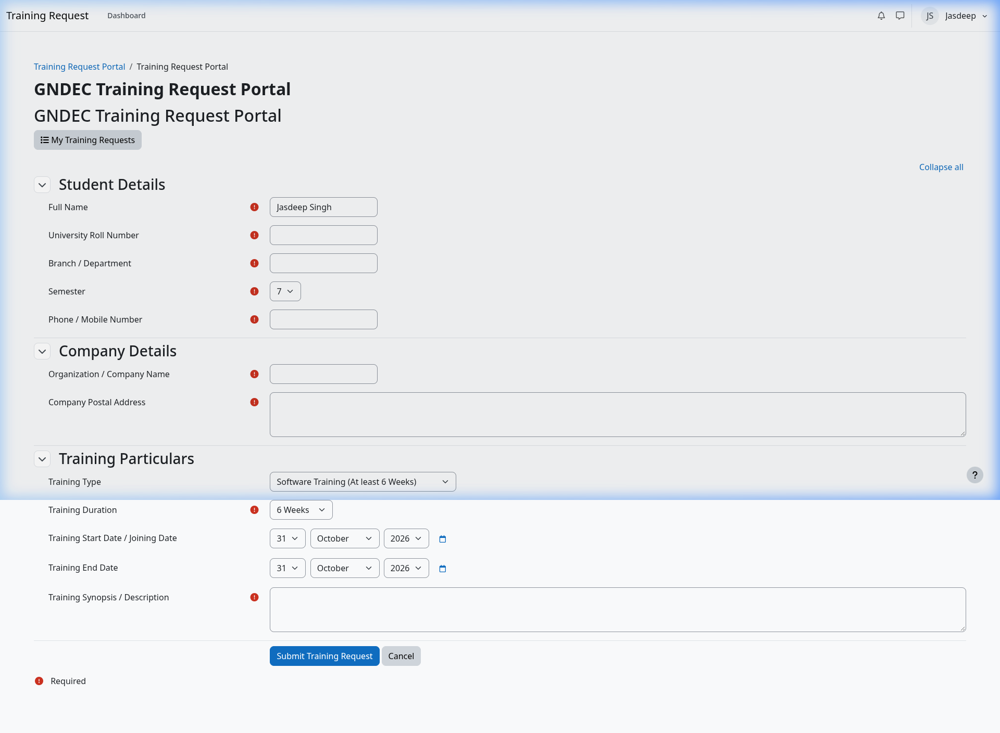
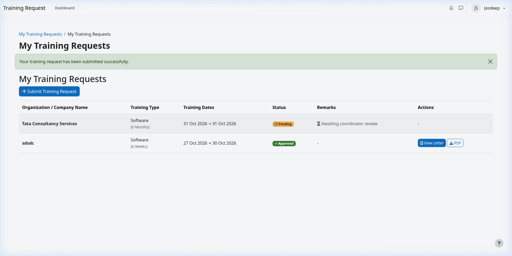
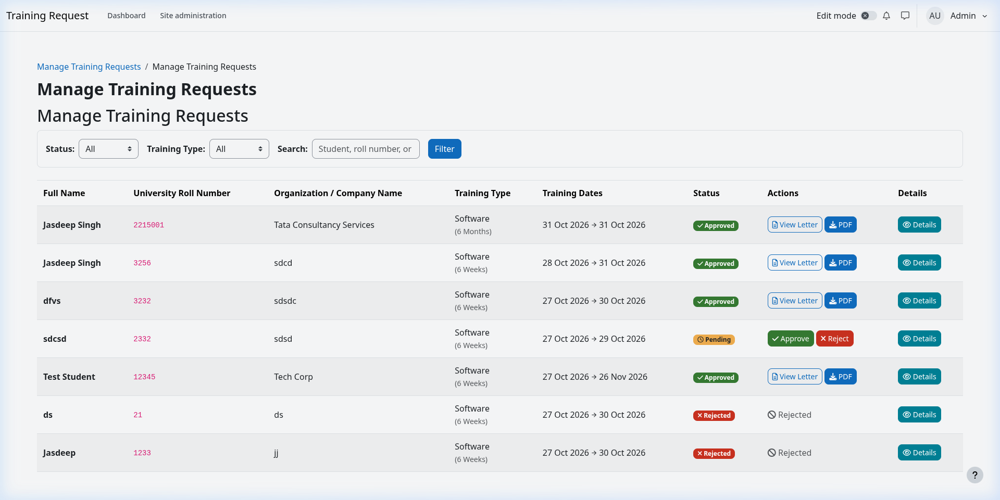
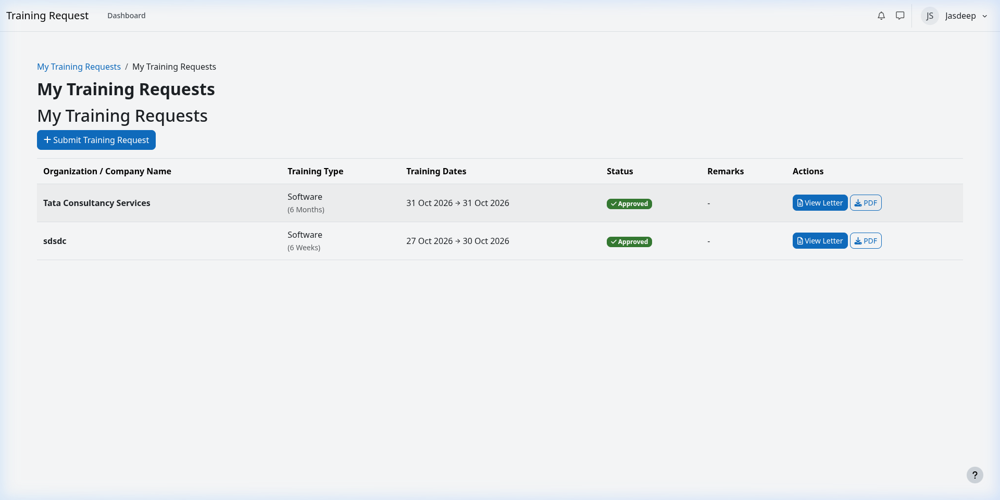
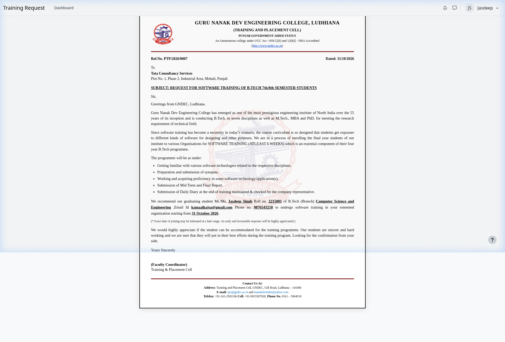

# GNDEC Training Request Letter Generator System
> **Moodle Local Plugin (`local_training_letter`)**  
> Developed for **Training & Placement (T&P) Cell, Guru Nanak Dev Engineering College, Ludhiana**.

---

## 📌 Overview
The **Training Request Letter Generator** allows students to submit their industrial or software training particulars through Moodle, validates and persists submissions using the Moodle Database API (`$DB`), and enables T&P coordinators to review, approve, or reject submissions with remarks. Upon approval, students can view and export an official, institutional GNDEC Training Request Letter formatted as an A4 PDF with college letterhead, official watermark, dynamic reference numbers, and coordinator endorsement blocks.

---

## 🏛 System Architecture & Core Modules

```
local/training_letter/
├── db/
│   ├── access.php              # Capability definitions (submitrequest, viewownrequests, reviewrequests)
│   ├── install.xml             # XMLDB schema definition (mdl_local_training_letter)
│   └── upgrade.php             # Incremental database migration script
├── lang/
│   └── en/
│       └── local_training_letter.php  # Localized language strings
├── pix/
│   └── gndec_logo.png          # Official GNDEC logo asset for header and watermark
├── details.php                 # Detailed view of student request particulars
├── download.php                # High-fidelity dynamic PDF export via TCPDF / Moodle pdf class
├── index.php                   # Student request submission portal with profile pre-fill
├── letter.php                  # In-browser preview of official GNDEC training letter
├── lib.php                     # Navigation menu extensions
├── manage.php                  # Coordinator administrative dashboard with filters & search
├── myrequests.php              # Student dashboard for tracking request statuses
├── request_form.php            # Moodle form definition using moodleform API & validation
├── review.php                  # Coordinator review action controller (approve / reject)
├── review_form.php             # Review form with optional remarks & required rejection reason
└── version.php                 # Plugin metadata and version tracking
```

---

## 🚀 Key Features

### 1. Student Request Form (`moodleform`)
* **Auto-Prefill from Profile**: Automatically loads student Name (`fullname($USER)`), Roll Number (`idnumber`), Branch (`department`), and Mobile Phone (`phone1`) from Moodle account.
* **Dual Training Types**: Select between **Software Training** (at least 6 Weeks) and **Industrial Training** (6 Months / Semester).
* **Robust Validation**:
  * 10-digit mobile number format verification.
  * Minimum alphanumeric roll number length check.
  * Date comparison (completion date must be after joining date).
  * Client-side and server-side validation via `validation()` rules.

### 2. Coordinator Review & Approval Workflow
* **Administrative Management View**: Clean table listing submissions with real-time status badges (`Pending`, `Approved`, `Rejected`).
* **Filtering & Search**: Instant filter by status (`All`, `Pending`, `Approved`, `Rejected`), training type (`Software`, `Industrial`), or search by student name, roll number, or company.
* **Review Remarks**: Coordinators can enter optional remarks/notes on approval (e.g., dispatch reference or conditions) or provide required reasons on rejection.

### 3. Official GNDEC Letter Generation (Web Preview & TCPDF)
* **Official GNDEC Formatting**: Incorporates the exact official format, wording, and curriculum bullets from GNDEC T&P cell templates (`gndec.ac.in/?q=node/90`):
  * **Software Training**: Official 55-year institutional preamble, 6-week curriculum bullets (syllabus, synopsis, daily diary, mid-term & final report), and Faculty Coordinator signature.
  * **Industrial Training**: Official 62-year institutional preamble, 6-month industrial project curriculum, and Training & Placement Officer signature (Prof. G.S. Sodhi).
* **Gated Release**: Download and preview links are unlocked only after coordinator approval.
* **High-Fidelity PDF**: Generates a standard A4 PDF complete with institutional outer border, watermark logo, maroon dividers, and T&P contact footer.

---

## 🛠 Installation & Deployment Guide

### Step 1: Deploy Plugin to Moodle
Place or symlink this directory into your local Moodle instance's `local/` folder:
```bash
# Example if Moodle is installed at /var/www/moodle
cd /var/www/moodle/local/
ln -s /path/to/training-request-system/training_letter training_letter
```

### Step 2: Run Database Upgrade
Log in to Moodle as an Administrator and visit the Site Administration notifications page:
```
http://localhost/admin/index.php
```
Or execute via the Moodle CLI:
```bash
php /var/www/moodle/admin/cli/upgrade.php
```
Moodle will automatically detect the plugin version (`2026103100`), execute `db/install.xml` and `db/upgrade.php`, and create the database table `mdl_local_training_letter`.

### Step 3: Purge Caches (if necessary)
```bash
php /var/www/moodle/admin/cli/purge_caches.php
```

---

## 🔒 Access Control & Capabilities

| Capability | Archetype / Default Roles | Purpose |
| :--- | :--- | :--- |
| `local/training_letter:submitrequest` | Student, Authenticated User | Allows students to fill and submit training requests. |
| `local/training_letter:viewownrequests` | Student, Authenticated User | Allows students to track their submission statuses and download letters. |
| `local/training_letter:reviewrequests` | Manager, Administrator, Editing Teacher | Allows coordinators to view all student submissions, approve, or reject. |

---

## 📸 Workflow Walkthrough & Screenshots

### 1. Student Request Portal with Profile Auto-Prefill
Students access `/local/training_letter/index.php` where their details are pre-filled:


### 2. Student Submission & Tracking
Submissions appear in `/local/training_letter/myrequests.php` with real-time status badges:


### 3. Coordinator Management & Approval
Coordinators review pending submissions on `/local/training_letter/manage.php` and approve with remarks:


### 4. Approved Request & Letter Release
Once approved, the status is updated with coordinator endorsement remarks:


### 5. Official GNDEC Training Letter Preview
Students and coordinators can preview the formatted official letter in-browser or download the generated PDF:


---

## 📄 Sample Exported PDF
A verified sample PDF generated through the Moodle TCPDF pipeline is available in:
* [`sample_output/GNDEC_Training_Letter_2215001_Sample.pdf`](sample_output/GNDEC_Training_Letter_2215001_Sample.pdf)
